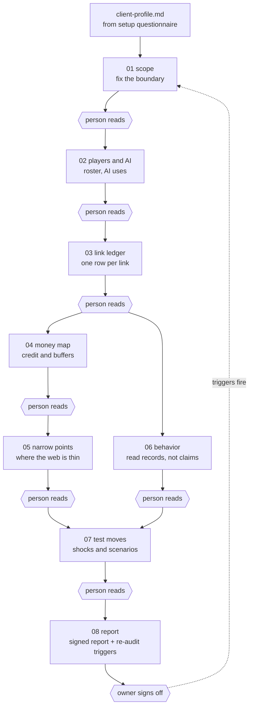

# Supply Web Audit Framework

A structured methodology for auditing risk across a supply web (not just a chain). Treats supply systems as infinite games where players enter, exit, and get recycled. Built on game theory principles and tested on cyber risk, financial risk, and operational resilience.

**Output:** One signed risk report + re-audit trigger list.

## What It Does

Maps a client's supply web across four core layers:
- **Technology** — infrastructure, integrations, data flows
- **Rules** — regulatory exposure, compliance obligations
- **Behavior** — access practices, incident response, key person dependencies
- **Money** — insurance, recovery costs, concentration risk

Traces links between players (top/middle/bottom tiers), finds narrow points (chokepoints), and tests shock scenarios before they happen.

## Quick Start

1. **Configure a client** — Run `setup/questionnaire.md`, write answers to `_shared/client-profile.md`
2. **Run the pipeline** — Execute stages `01_` through `08_` in sequence
3. **Human gate at each stage** — No stage advances until a person reads the output
4. **Output:** Signed report + trigger list for re-audit

Total time: 2–4 weeks per audit (depends on data availability).

## How It Works



Each stage reads the output of the stages before it. The hexagons are the human gates. The dotted line is the infinite game: when a re-audit trigger fires, the loop starts again.

```
01_scope          → Fix the boundary (what's in, what's out)
02_players-and-ai → Roster players, map AI uses
03_link-ledger    → Write each relationship (who buys from whom, terms, risk)
04_money-map      → Trace credit and buffers (who has cash, insurance, SLAs)
05_narrow-points  → Find where the web is thin (chokepoints, single points of failure)
06_behavior       → Read behavior from records (patterns, incidents, slack)
07_test-moves     → Test shocks and moves (what if X fails, what's recovery time?)
08_report         → Report and set triggers (signed output + re-audit schedule)
```

**Key principle:** Nothing moves to the next stage until a person has read and approved the output of the last one.

## Usage Examples

Open the folder in any file-reading agent (Claude Code, Codex, Gemini CLI) and paste the prompt. The agent starts at `AGENTS.md` and loads only what the current stage lists.

**1. Configure a new client**
```
Read AGENTS.md. New client copy. Run setup/questionnaire.md with me,
one question at a time, then write my answers to _shared/client-profile.md.
```

**2. Run a stage**
```
Run stage 01_scope. Client brief is in client-records/brief.txt.
Stop when scope.md is written so I can read it.
```

**3. Approve and advance**
```
Scope confirmed. Run stage 02_players-and-ai.
```

**4. Fix an output before moving on**
```
Narrow-points.md missed the payment processor. Add it, label the claim
Established or Gap, and wait for me to re-read before stage 06.
```

**5. Check status**
```
What stages are complete? Scan stages/*/output/ and tell me what is next.
```

**6. Pressure-test a finding**
```
In behavior.md, give the best alternative explanation for each score
and flag any score the records alone don't support.
```

**7. Re-audit after a trigger fires**
```
Trigger fired: our top lender cut a credit line. Open stage 08's trigger
list, re-run only the stages that trigger touches, and diff against the last report.
```

**8. Try it without client data**
```
Read examples/apex/client-profile.md and docs/AUDIT_EXAMPLE.md, then run
stages 01 to 03 on Apex so I can see the shape of each output.
```

## Directory Structure

```
.
├── README.md                 # This file
├── AGENTS.md                 # Entry file for any agent (ICM: folders, hierarchy, files)
├── CONTEXT.md                # Pipeline table and stage contracts
├── CONTRIBUTING.md           # How to extend without breaking ICM
├── LICENSE                   # MIT
├── setup/
│   └── questionnaire.md      # One-time client configuration
├── stages/                   # The pipeline, in execution order
│   ├── 01_scope/             # Each stage: CONTEXT.md + output/ (+ references/)
│   ├── 02_players-and-ai/
│   ├── 03_link-ledger/
│   ├── 04_money-map/
│   ├── 05_narrow-points/
│   ├── 06_behavior/
│   ├── 07_test-moves/
│   └── 08_report/
├── _shared/                  # Factory (stable every run)
│   ├── client-profile.md     # Blank until you run setup
│   ├── principles.md         # Framework principles
│   ├── layers-and-tiers.md   # Layer definitions + tier rules
│   ├── payoffs-and-drivers.md # What players want and what moves them
│   └── evidence-labels.md    # How to label claims (Established/Author/Gap)
├── _templates/               # Blank starters (copy, never edit directly)
├── docs/                     # Full framework reference + worked example
├── examples/apex/            # Filled demo profile and scope (fictional client)
└── client-records/           # Drop client files here (contents gitignored)
```

## Evidence Labeling

Every claim in output is labeled:
- **Established** — From client records, public sources, or signed documentation
- **Author's construction** — Framework reasoning, derived from established facts
- **Gap** — Data we don't have yet; why it matters; how to fill it

This signals confidence to readers (board, counsel, acquirer).

## For Cyber Risk Specifically

- **Technology layer:** AWS posture, API integration security, secret management, encryption
- **Rules layer:** GDPR/SOX/state privacy exposure, breach notification timelines, incident reporting
- **Behavior layer:** Vendor access logs, patch discipline, incident response playbook, key person redundancy
- **Money layer:** Insurance coverage, recovery cost estimates, SLA liability, concentration by revenue

See `docs/AUDIT_EXAMPLE.md` for a worked demo, and `examples/apex/` for its filled profile and scope (Apex Digital Services, fictional).

## Using This Framework

### For your own audit
1. Clone or copy this repo, one copy per client
2. Open it in any agent (Claude Code, Codex, Gemini CLI) and say: "Read AGENTS.md and run setup"
3. Answer `setup/questionnaire.md`; the agent writes `_shared/client-profile.md`
4. Say: "Run stage 01." Read the output, confirm, then move to the next stage
5. Repeat through `08_report`

Put client files in `client-records/`. They stay out of git.

### For GitHub publishing
Keep client copies private. Publish only this framework, with `examples/` as the demo.

## Contributing

- **Framework principles** live in `_shared/principles.md` (read before editing stages)
- **Stage contracts** are in each stage's `CONTEXT.md` (defines input/output/human check)
- **Templates** in `_templates/` are starters only (copy before editing)

If you test this on a new risk domain (supply chain, geopolitical, operational), document what changes in the layers or tier definitions.

## License

MIT. See `LICENSE`. Contributions: see `CONTRIBUTING.md`.

---

**Questions?** See `CONTEXT.md` (pipeline overview) or read a stage's `CONTEXT.md` (what that stage expects).
