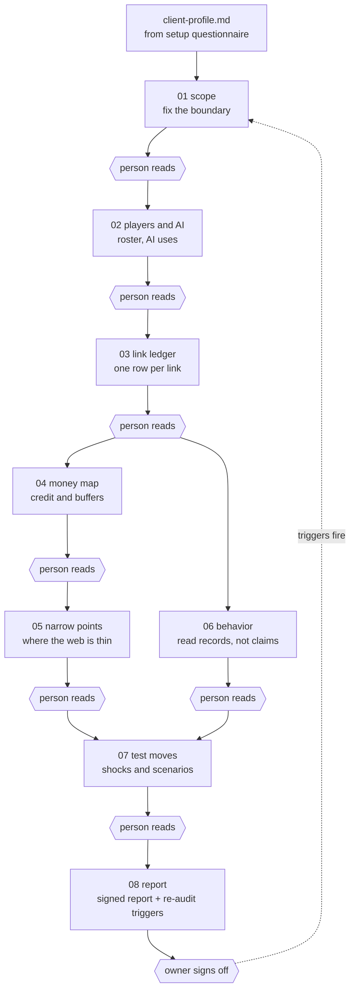

# Supply Web Audit Framework

A file-based workspace that an AI agent (or a person) walks to audit one client's supply web: the players, the links between them, where the money flows, and where the web is thin. It treats a supply system as an infinite game, where players enter, exit, and get recycled, so the audit ends with a list of triggers that say when to run it again.

It is built as an ICM workspace (Interpretable Context Methodology): folders carry the sequence, hierarchy carries the context, and files carry the state. There is no code to install. Any agent that can read and write files can run it, and a person can run it by hand.

**Input:** a client brief and their records. **Output:** one signed risk report and a re-audit trigger list. The worked example is cyber risk; the layers are domain-neutral.

## In Plain English

**The problem.** Most businesses know their suppliers and customers. Few know the web behind them: who their supplier depends on, who lends to everyone in the chain, and which single company, bank, or tool would stall the whole thing if it failed. Those hidden dependencies are where surprises come from.

**What this does.** It walks you through mapping that web step by step, then shows where it is thin, how the people in it tend to behave under pressure, and what happens if one piece breaks. You finish with a written report and a short list of events that mean "audit this again."

**Who it's for**
- **Owners and operators of small and mid-size businesses** who want to see their real exposure before a lender, buyer, or crisis shows it to them.
- **Auditors, risk consultants, and advisors** who need a repeatable process they can hand to a client and defend.
- **Boards, lenders, and acquirers' counsel** who need to know what was checked, what is proven, and what is still unknown.
- **Anyone using an AI agent for analysis** who wants it to follow a method and show its evidence instead of improvising.

**Why it's valuable**
- **It shows the whole web, not just your direct suppliers.** The risk usually sits one or two steps away.
- **It separates what is known from what is guessed.** Every claim is labeled Established, Author's construction, or Gap, so readers see how far to trust it.
- **A person checks every step.** Nothing moves forward until someone has read and confirmed the last output, so an AI cannot quietly run ahead.
- **It is repeatable.** Same steps, same files, same report shape every time. The triggers tell you when to re-run it instead of leaving it on a shelf.
- **It is cheap to adopt.** No software to install, no subscription. A form for collecting information and a folder of plain files.

**Why it was built.** Read the one-page memo: [docs/WHY.md](docs/WHY.md).

**What it is not.** It is not legal, financial, or insurance advice, and it does not predict the future. It is a structured way to find and document dependencies and weak points so people can decide what to do about them.

## What It Does

Audits across seven layers (money, physical, rules, narrative, technology, behavior, ecology). The cyber-risk example leans on four:
- **Technology** — infrastructure, integrations, data flows
- **Rules** — regulatory exposure, compliance obligations
- **Behavior** — access practices, incident response, key person dependencies
- **Money** — insurance, recovery costs, concentration risk

Traces links between players (top/middle/bottom tiers), finds narrow points (chokepoints), and tests shock scenarios before they happen.

## Quick Start

1. **Configure a client** — Run `setup/questionnaire.md`, write answers to `_shared/client-profile.md`
2. **Run the pipeline** — Execute stages `01_` through `08_` in sequence
3. **Human gate at each stage** — No stage advances until a person reads the output
4. **Output:** Signed report + trigger list for re-audit

Total time: 2–4 weeks per audit (depends on data availability).

## How It Works



Each stage reads the output of the stages before it. The hexagons are the human gates. The dotted line is the infinite game: when a re-audit trigger fires, the loop starts again.

```
01_scope          → Fix the boundary (what's in, what's out)
02_players-and-ai → Roster players, map AI uses
03_link-ledger    → Write each relationship (who buys from whom, terms, risk)
04_money-map      → Trace credit and buffers (who has cash, insurance, SLAs)
05_narrow-points  → Find where the web is thin (chokepoints, single points of failure)
06_behavior       → Read behavior from records (patterns, incidents, slack)
07_test-moves     → Test shocks and moves (what if X fails, what's recovery time?)
08_report         → Report and set triggers (signed output + re-audit schedule)
```

**Key principle:** Nothing moves to the next stage until a person has read and approved the output of the last one.

## Intake Form (for auditors)

`tools/intake-form.html` is a single-file form. Double-click it to open in any browser. No install, no server, nothing uploaded.

It covers the client profile, the players, AI uses, and the link ledger, with the same fields the pipeline reads. Export buttons write files in the exact formats the stages expect:

Save every export into `intake/` (gitignored, since it holds client data). The pipeline picks each one up from there:

| Section | Exports | Picked up by |
|---|---|---|
| Client profile | `client-profile.md` | setup, which confirms it with the owner and copies it to `_shared/` |
| Players | `roster.md` | stage `02_players-and-ai` |
| AI uses | `ai-uses.md` | stage `02_players-and-ai` |
| Link ledger | `ledger.csv` | stage `03_link-ledger` |

The stages treat intake files as drafts: they keep your evidence labels, verify each row against records, and write the confirmed result to `output/`. The human gate still applies.

**Formats.** The Format menu at the bottom switches every export, and each section also has a Copy button for the clipboard:

| Format | Use it for |
|---|---|
| Pipeline (default) | the exact `.md` and `.csv` files the stages read |
| Markdown | tables for docs, wikis, GitHub, Obsidian |
| Plain text | email, chat, notes; one `key: value` block per record |
| CSV | Excel, Google Sheets, databases |
| TSV | paste straight into a spreadsheet |
| JSON | scripts, APIs, other tools |

Only Pipeline output is read by the stages. The other formats are copies of the same data for sharing or analysis.

Rows start labeled `Gap`; change a row to Established or Author's construction only when the record supports it. Progress autosaves in the browser, and **Save session** writes a `.json` you can reload later or hand to a colleague. Exported drafts still go through the human gate: the agent or auditor reads them before the next stage runs.

## Using It With Different Agents

Every agent starts from one entry file, `AGENTS.md`. `CLAUDE.md` and `GEMINI.md` are one-line pointers to it, so each tool's native entry file lands in the same place.

| Tool | How to start |
|---|---|
| Claude Code | `cd` into the folder, run `claude`. It loads `CLAUDE.md`, which points to `AGENTS.md`. |
| Codex CLI | `cd` into the folder, run `codex`. It reads `AGENTS.md` directly. |
| Gemini CLI | `cd` into the folder, run `gemini`. It loads `GEMINI.md`, which points to `AGENTS.md`. |
| Cursor, Windsurf, Copilot agent mode, Cline | Open the folder as the workspace. If the tool does not pick up `AGENTS.md` on its own, start with: `Read AGENTS.md and follow it.` |
| Aider | `aider --read AGENTS.md --read CONTEXT.md`, then add each stage's files as you reach it. |
| Chat app with file upload (Claude.ai, ChatGPT) | Upload the folder or zip. Say: `Read AGENTS.md and follow it.` The chat cannot save files, so copy each stage's output into `stages/NN_name/output/` yourself before the next stage. |
| Chat app, no upload | Paste `AGENTS.md`, `CONTEXT.md`, then the current stage's `CONTEXT.md` and the files it lists. Paste each output back in as input to the next stage. |
| No agent | Open each stage's `CONTEXT.md` and follow its Process. The Inputs list says what to read, Outputs says what to write. |

Notes that apply to all of them:
- Tools that can read and write files carry state for you: a stage is complete when its `output/` holds an artifact, so you can close the session and resume with `What stages are complete?`
- Sandboxed or read-only agents can draft outputs but will not save them. Paste the draft into the right `output/` folder yourself.
- Keep client files in `client-records/`. Do not paste them into an agent whose data policy you have not checked.
- The agent's job is the stage, not the pipeline. If one tries to run several stages in a row, remind it of the rule: nothing advances until you have read the last output.

## Usage Examples

Open the folder in any file-reading agent (Claude Code, Codex, Gemini CLI) and paste the prompt. The agent starts at `AGENTS.md` and loads only what the current stage lists.

**1. Configure a new client**
```
Read AGENTS.md. New client copy. Run setup/questionnaire.md with me,
one question at a time, then write my answers to _shared/client-profile.md.
```

**2. Run a stage**
```
Run stage 01_scope. Client brief is in client-records/brief.txt.
Stop when scope.md is written so I can read it.
```

**3. Approve and advance**
```
Scope confirmed. Run stage 02_players-and-ai.
```

**4. Fix an output before moving on**
```
Narrow-points.md missed the payment processor. Add it, label the claim
Established or Gap, and wait for me to re-read before stage 06.
```

**5. Check status**
```
What stages are complete? Scan stages/*/output/ and tell me what is next.
```

**6. Pressure-test a finding**
```
In behavior.md, give the best alternative explanation for each score
and flag any score the records alone don't support.
```

**7. Re-audit after a trigger fires**
```
Trigger fired: our top lender cut a credit line. Open stage 08's trigger
list, re-run only the stages that trigger touches, and diff against the last report.
```

**8. Try it without client data**
```
Read examples/apex/client-profile.md and docs/AUDIT_EXAMPLE.md, then run
stages 01 to 03 on Apex so I can see the shape of each output.
```

## Directory Structure

```
.
├── README.md                 # This file
├── AGENTS.md                 # Entry file for any agent (ICM: folders, hierarchy, files)
├── CONTEXT.md                # Pipeline table and stage contracts
├── CONTRIBUTING.md           # How to extend without breaking ICM
├── LICENSE                   # MIT
├── setup/
│   └── questionnaire.md      # One-time client configuration
├── stages/                   # The pipeline, in execution order
│   ├── 01_scope/             # Each stage: CONTEXT.md + output/ (+ references/)
│   ├── 02_players-and-ai/
│   ├── 03_link-ledger/
│   ├── 04_money-map/
│   ├── 05_narrow-points/
│   ├── 06_behavior/
│   ├── 07_test-moves/
│   └── 08_report/
├── _shared/                  # Factory (stable every run)
│   ├── client-profile.md     # Blank until you run setup
│   ├── principles.md         # Framework principles
│   ├── layers-and-tiers.md   # Layer definitions + tier rules
│   ├── payoffs-and-drivers.md # What players want and what moves them
│   └── evidence-labels.md    # How to label claims (Established/Author/Gap)
├── _templates/               # Blank starters (copy, never edit directly)
├── tools/intake-form.html    # Offline form that exports profile, roster, AI uses, ledger
├── intake/                   # Drop the form's exports here (contents gitignored)
├── docs/                     # Full framework reference + worked example
├── examples/apex/            # Filled demo profile and scope (fictional client)
└── client-records/           # Drop client files here (contents gitignored)
```

## Evidence Labeling

Every claim in output is labeled:
- **Established** — From client records, public sources, or signed documentation
- **Author's construction** — Framework reasoning, derived from established facts
- **Gap** — Data we don't have yet; why it matters; how to fill it

This signals confidence to readers (board, counsel, acquirer).

## For Cyber Risk Specifically

- **Technology layer:** AWS posture, API integration security, secret management, encryption
- **Rules layer:** GDPR/SOX/state privacy exposure, breach notification timelines, incident reporting
- **Behavior layer:** Vendor access logs, patch discipline, incident response playbook, key person redundancy
- **Money layer:** Insurance coverage, recovery cost estimates, SLA liability, concentration by revenue

See `docs/AUDIT_EXAMPLE.md` for a worked demo, and `examples/apex/` for its filled profile and scope (Apex Digital Services, fictional).

## Using This Framework

### For your own audit
1. Clone or copy this repo, one copy per client
2. Open it in any agent (Claude Code, Codex, Gemini CLI) and say: "Read AGENTS.md and run setup"
3. Answer `setup/questionnaire.md`; the agent writes `_shared/client-profile.md`
4. Say: "Run stage 01." Read the output, confirm, then move to the next stage
5. Repeat through `08_report`

Put client files in `client-records/`. They stay out of git.

### For GitHub publishing
Keep client copies private. Publish only this framework, with `examples/` as the demo.

## Contributing

- **Framework principles** live in `_shared/principles.md` (read before editing stages)
- **Stage contracts** are in each stage's `CONTEXT.md` (defines input/output/human check)
- **Templates** in `_templates/` are starters only (copy before editing)

If you test this on a new risk domain (supply chain, geopolitical, operational), document what changes in the layers or tier definitions.

## License

MIT. See `LICENSE`. Contributions: see `CONTRIBUTING.md`.

---

**Questions?** See `CONTEXT.md` (pipeline overview) or read a stage's `CONTEXT.md` (what that stage expects).
